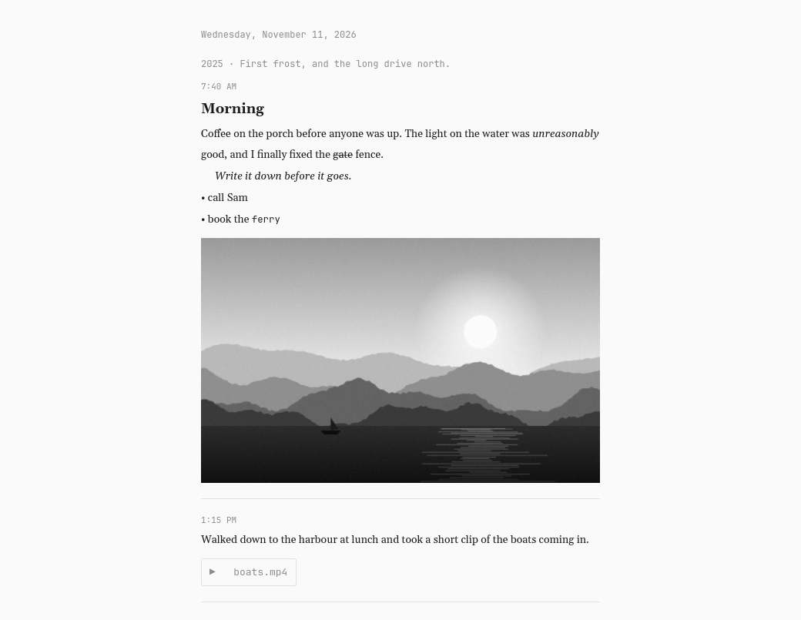
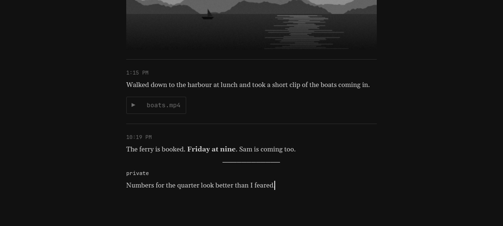
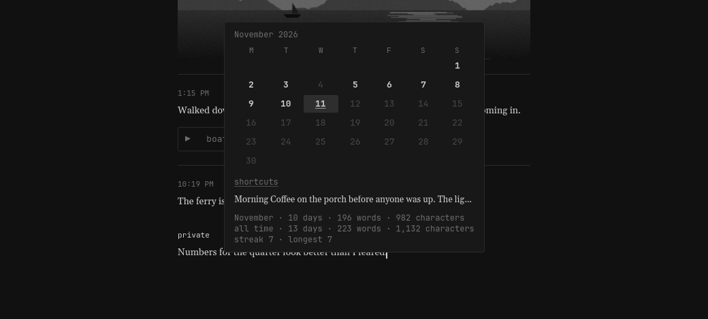
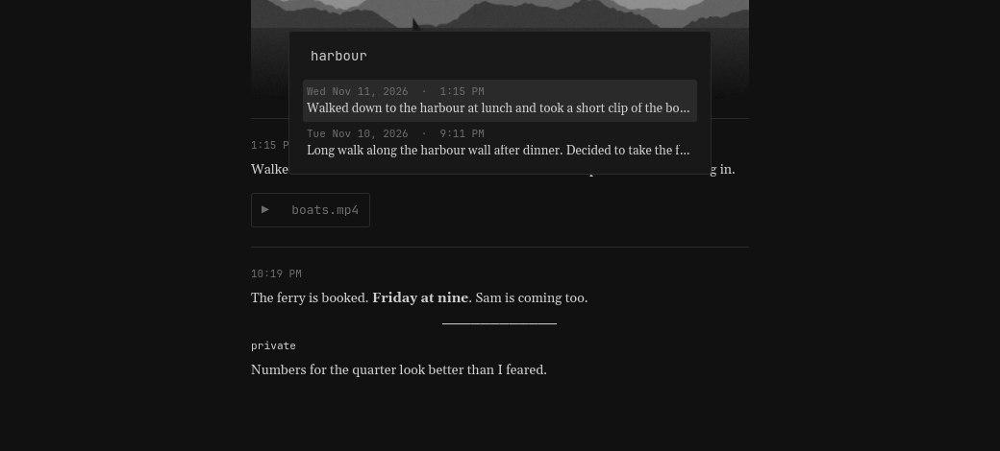

<h1>
  <picture>
    <source media="(prefers-color-scheme: dark)" srcset="assets/logo/wordmark-dark.svg">
    
  </picture>
</h1>

A private daily journal for Omarchy. Just a cursor and text.

Jot opens to today, timestamps what you write, and keeps everything
encrypted on your own disk. There are no toolbars, no sidebars and no
accounts. Every feature is a keystroke away and invisible until you ask for it.



## Why it exists

Most journaling apps are either a web page pretending to be an app, or a
note-taking system with a journal bolted on. Jot does one thing: it gets
out of the way so you write. It is a native Rust and GTK4 app, opens instantly,
and works fully offline.

## Writing

- **A page per day.** Open the app and type. Each entry is stamped with the
  time of its first words. Ctrl+Enter finishes it and starts the next, so a day
  reads as a series of dated thoughts separated by a hairline rule.
- **Append-only.** A finished entry is final. The journal is an honest record
  of what you thought at the time, not a document you keep polishing.
- **Rich text with no visible markup.** Bold, italic, strikethrough, code,
  headings, quotes and bullet lists are all keyboard shortcuts. You never see an
  asterisk or a pound sign while writing.
- **Dividers.** Ctrl+Shift+D drops a short rule mid-entry, for separating
  personal thoughts from work musings inside one sitting.
- **Georgia for your words.** Entries are set in Georgia (or Gelasio, its open
  twin, when Georgia is not installed). Dates, times and menus use your system
  monospace font, so the chrome matches your Omarchy setup and your writing
  stands apart from it.
- **Typewriter scrolling.** The line you are writing stays around mid-screen.
- **Text size.** Ctrl+= and Ctrl+- resize everything, and the column scales
  with it.
- **Light and dark.** Follows your system setting; Ctrl+D flips it. Entirely
  monochrome either way.



## Photos and videos

Paste an image, drop files on the window, or press Ctrl+O. Attachments are
copied into the vault and encrypted like everything else, so an entry never
breaks because a file moved. Photos show inline under the entry; videos play in
place when you click them.

## Looking back

- **Calendar.** Ctrl+M, or hover the date and click the `≡` that appears. Days
  you wrote are bold, today is underlined, and arrow keys move through days,
  weeks and months with a preview of each day.
- **Streaks and totals.** The same panel shows days written, words and
  characters for the month and for all time, plus your current and longest
  streak.
- **On this day.** If you wrote on this date in an earlier year, a single quiet
  line under the date shows it. Click to open that day.
- **Search.** Ctrl+F searches every entry as you type. Typing part of a date,
  such as `2026-11`, finds that month.
- **Day to day.** Alt+Left and Alt+Right step through the days you wrote.





## Privacy

- **Encrypted at rest.** Every entry and attachment is sealed with
  XChaCha20-Poly1305 under a key derived from your password with Argon2id.
  Nothing readable ever touches the disk, including search data, which lives
  only in memory while the app is unlocked.
- **Locks itself.** After five idle minutes, when the machine sleeps, and when
  the session locks. Ctrl+L locks it now.
- **No recovery.** There is no back door. A forgotten password means the
  journal is gone. Ctrl+Shift+K changes the password when you know the old one.
- **Privacy mode.** Ctrl+Shift+P hides everything except the last few
  characters you typed, so you can write on a plane or in a café. Each new
  character pushes one off the edge, like a ticker. Ctrl+[ and Ctrl+] show
  fewer or more, down to a single character.
- **Private sections.** Ctrl+Shift+H marks the section you are in as private:
  the text between two dividers, or the whole entry if it has none. Private
  sections are never handed to agents.


## Your data stays yours

- **Markdown export.** Ctrl+Shift+E, or `jot export <folder>`, writes one
  plain `YYYY-MM-DD.md` file per day plus a `media` folder. Open the result
  directly in Obsidian or anything else.
- **Encrypted backup.** `jot backup <folder>` copies the vault as it is,
  still encrypted, and repeats automatically every time the journal locks.
- **Sync between your machines.** `jot sync <host>` does a two-way sync
  with another machine over SSH, for example one on your tailnet. Only
  encrypted files travel and nothing is ever deleted. After the first run it
  syncs on every unlock and lock. Two journals that were created separately are
  never mixed.

## Agents

Jot can be read by an AI agent, on your terms. Access is read-only, works
only while the app is unlocked, and never includes private sections.

- **Ask and summarize.** `jot summarize` writes up your week or month, and
  `jot ask <question>` answers anything about your recent entries. Both use
  the agent you chose with `omarchy default agent`. Add `--ollama` to keep it on
  your machine with a local model. With a cloud agent, the entries in that
  period are sent to it, and the command says so each time.
- **MCP server.** `jot mcp` exposes search and read tools to any MCP
  client. For Claude Code: `claude mcp add jot -- jot mcp`.
- **Plain commands.** `jot search`, `jot read` and `jot days` work
  from any shell or script.

## Install

Download the latest release and run the installer. It puts the app in
`~/.local/bin`, adds the launcher entry and icon, and installs the fallback
font. Nothing needs compiling. It needs `gtk4` and GStreamer, which Omarchy
already has.

```bash
gh release download -R omarsimon-1/jot -p '*.tar.gz' -O - | tar -xz && jot-linux-x86_64/install.sh
```

Then open Jot from the app launcher. The first launch asks you to choose a
password.

### Bar button

This repository is also an Omarchy shell plugin that adds a bar button to open
Jot. The plugin is only the button; the app comes from the installer.

```bash
omarchy plugin add https://github.com/omarsimon-1/jot.git --enable
```

### Keybinding

Add to `~/.config/hypr/bindings.lua`:

```lua
o.bind("SUPER + SHIFT + J", "Jot", "omarchy-launch-or-focus app.jot.Jot 'uwsm-app -- jot'")
```

## Shortcuts

Press Ctrl+/ or F1 in the app for this list.

| Keys | Action |
|---|---|
| Ctrl+Enter | Finish this entry, start the next |
| Ctrl+B / Ctrl+I | Bold / italic |
| Ctrl+Shift+S | Strikethrough |
| Ctrl+E | Code |
| Ctrl+1 / Ctrl+2 / Ctrl+0 | Heading / subheading / body |
| Ctrl+Shift+Q | Quote |
| Ctrl+Shift+L | Bullet list |
| Ctrl+Shift+D | Divider |
| Ctrl+Shift+H | Keep this section private from agents |
| Ctrl+Shift+P | Privacy mode |
| Ctrl+[ / Ctrl+] | Fewer / more characters shown in privacy mode |
| Ctrl+O | Attach photos or videos |
| Ctrl+Shift+Backspace | Remove the last attachment |
| Alt+Left / Alt+Right | Previous / next day |
| Ctrl+T | Today |
| Ctrl+M | Calendar and totals |
| Ctrl+F | Search |
| Ctrl+Shift+E | Export to markdown |
| Ctrl+= / Ctrl+- | Text size |
| Ctrl+D | Light / dark |
| Ctrl+L | Lock |
| Ctrl+Shift+K | Change password |

## Command line

Run `jot help` for the full list. Search, read, export, summarize and ask
need the app running and unlocked. Sync and backup move only encrypted files
and work whether or not the app is open.

## Where things live

| What | Where |
|---|---|
| Encrypted vault | `~/.local/share/jot` (override with `JOT_DIR`) |
| Settings (text size, sync host, backup folder) | `~/.config/jot` |
| Agent socket | `$XDG_RUNTIME_DIR/jot.sock`, readable only by you |

## Build from source

```bash
cargo build --release && ./install.sh
```

Run the tests with `cargo test`.

## License

MIT. The bundled Gelasio font is under the SIL Open Font License; see
`assets/fonts/OFL.txt`.
